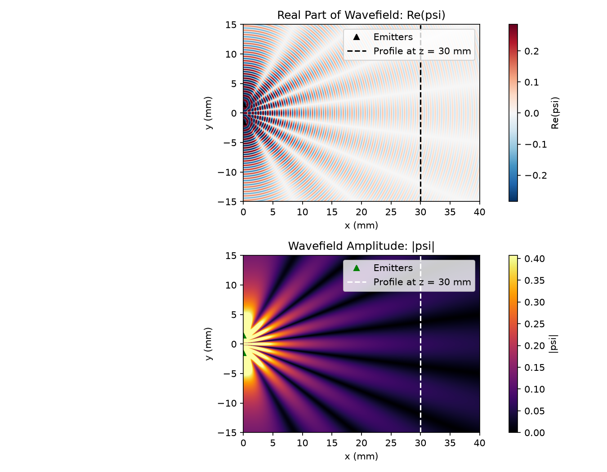
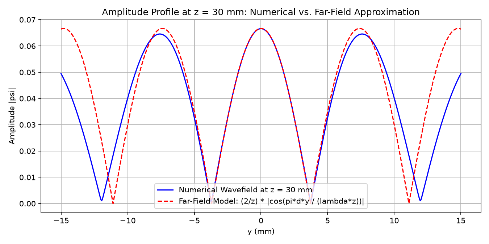

# Young's Double Slit Ultrasound Experiment

## Overview
Simulation of two coherent spherical ultrasound waves emitted on the left edge of a plane (at $x = 0$, separated by distance $d = 3.0\text{ mm}$) and propagating to the right in water ($c = 1480\text{ m/s}, f = 2.0\text{ MHz}, \lambda = 0.74\text{ mm}$).

### Visualizations
- **Real Part $\operatorname{Re}\{\psi(x, y)\}$**: Shows propagating wavefronts and phase interference.
- **Amplitude $|\psi(x, y)|$**: Shows constructive and destructive interference lobes.

### Amplitude Profile at Distance $z = 30\text{ mm}$
At a sufficiently large distance $z$ ($z \gg d$), the amplitude profile is calculated analytically using the far-field Fraunhofer approximation / spatial Fourier transform:
$$|\psi_{\text{far}}(z, y)| \approx \frac{2}{z} \left| \cos\left( \frac{\pi d y}{\lambda z} \right) \right|$$

## Repository Structure
- `Youngs_double_slit_exp_Nachiketh.ipynb`: Jupyter notebook containing the full simulation and plots.
- `Youngs_double_slit_exp_Nachiketh_wavefield.png` / `.pdf`: Wavefield Real Part & Amplitude plots.
- `Youngs_double_slit_exp_Nachiketh_profile.png` / `.pdf`: Profile comparison at distance $z = 30\text{ mm}$.
- `README.md`: Project summary.
